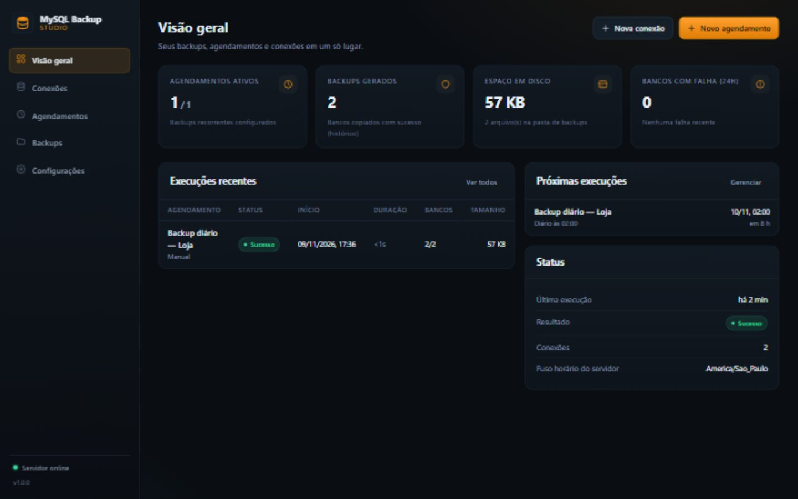

# MySQL Backup Studio

Alternativa local ao SQLBackupAndFTP para **backup agendado de bancos MySQL e MariaDB**, com interface web, seleção de bancos (ou todos), retenção automática e restauração — sem limite de bancos e sem assinatura.



## O que ele faz

- **Conexões MySQL/MariaDB** salvas com senha criptografada (AES-256-GCM).
- **Seleção de bancos**: escolha bancos específicos ou "Todos os bancos" (inclui bancos criados no futuro).
- **Backup agendado**: manual, diário, semanal ou expressão cron (ex.: `0 */6 * * *`).
- **Backup nativo**: gera `.sql.gz` pelo próprio app, sem precisar instalar `mysqldump`. Inclui estrutura, dados, views, procedures, functions, triggers e events.
- **Snapshot consistente** de tabelas InnoDB (`START TRANSACTION WITH CONSISTENT SNAPSHOT`).
- **Retenção automática**: mantenha os últimos N backups por banco e/ou apague arquivos com mais de X dias.
- **Histórico e monitoramento** em tempo real do progresso (tabela e linhas lidas).
- **Restauração** pela interface, escolhendo a conexão e o banco de destino.
- **Download** de qualquer arquivo `.sql.gz`.
- **Tudo local**: servidor escuta em `127.0.0.1`, dados em `data/`.

## Requisitos

- Node.js **18+** (testado com Node 24).
- MySQL **5.7/8.0** ou MariaDB **10.x**.
- Windows, Linux ou macOS.

## Instalação

```bash
cd MySqlBackupAndFtp
npm install
npm start
```

Abra **http://127.0.0.1:3010**.

No Windows, também é possível dar duplo clique em **`start.cmd`** — ele instala as dependências na primeira execução, abre o navegador e inicia o servidor.

Variáveis opcionais:

| Variável       | Padrão            | Descrição                              |
| -------------- | ----------------- | -------------------------------------- |
| `PORT`         | `3010`            | Porta do servidor web                  |
| `HOST`         | `127.0.0.1`       | Interface de rede (mantenha local)     |
| `MBS_DATA_DIR` | `./data`          | Pasta de configuração e backups        |

## Usuário MySQL

Para **gerar backups**, crie um usuário com permissões de leitura:

```sql
CREATE USER 'backup'@'%' IDENTIFIED BY 'senha-forte';
GRANT SELECT, SHOW VIEW, TRIGGER, EVENT, SHOW_ROUTINE ON *.* TO 'backup'@'%';
FLUSH PRIVILEGES;
```

- `TRIGGER`, `EVENT` e `SHOW_ROUTINE` permitem ler as definições de triggers, events, procedures e functions.
- Em **MariaDB** e em **MySQL anterior ao 8.0.20** não existe o privilégio `SHOW_ROUTINE`. Nesse caso use:

```sql
GRANT SELECT, SHOW VIEW, TRIGGER, EVENT ON *.* TO 'backup'@'%';
```

- Para restaurar, a conexão de destino precisa de permissões de escrita (`CREATE`, `DROP`, `ALTER`, `INSERT`, `UPDATE`, `DELETE`, `CREATE ROUTINE`, `ALTER ROUTINE`, `TRIGGER`, `EVENT`) ou simplesmente `ALL` no banco de destino.

## Como usar

1. **Conexões → Nova conexão**: informe host, porta, usuário e senha. Use **Testar conexão**.
2. **Agendamentos → Novo agendamento**:
   - escolha a conexão;
   - marque um ou mais bancos (ou **Todos os bancos**);
   - escolha a frequência e o horário;
   - defina a retenção (ex.: manter 7 backups, ou apagar após 30 dias);
   - salve.
3. Clique em **Executar** para gerar o primeiro backup imediatamente.
4. Acompanhe o progresso na **Visão geral** e baixe/restaure em **Backups**.

> O agendador só executa enquanto o aplicativo estiver rodando. Veja abaixo como iniciar junto com o Windows.

## Onde ficam os arquivos

```
data/
├── app.json               # conexões, agendamentos e histórico
├── .key                   # chave local de criptografia (não compartilhe)
├── tmp/                   # arquivos temporários de restauração
└── backups/
    └── <job-id>/
        ├── loja__20261109-173027215.sql.gz
        └── outra__20261109-173027350.sql.gz
```

O nome do arquivo segue `<banco>__AAAAMMDD-HHMMSSmmm.sql.gz` no horário local.

## Restauração

Em **Backups**, clique em **Restaurar** no banco desejado:

- escolha a **conexão de destino**;
- confirme o **banco de destino** (pode ser diferente do original);
- opcionalmente marque **Apagar e recriar o banco de destino**.

O backup executa `DROP TABLE` das tabelas presentes no arquivo antes de recriá-las. Tabelas do destino que não existem no backup permanecem, a menos que "apagar e recriar" seja marcado.

Também é possível restaurar pela linha de comando:

```bash
gunzip -c loja__20261109-173027215.sql.gz | mysql -h host -u user -p meu_banco
```

## Iniciar junto com o Windows

1. Abra o **Agendador de Tarefas** do Windows.
2. **Criar tarefa básica** → "Ao fazer logon".
3. Ação: **Iniciar um programa** → `C:\Program Files\nodejs\node.exe`.
4. Argumentos: `src\server.js`; **Iniciar em**: `C:\Workspaces\MySqlBackupAndFtp`.

Alternativa: crie um atalho para `start.cmd` na pasta `shell:startup` (`Win+R` → `shell:startup`).

## Segurança

- Senhas do MySQL são gravadas **criptografadas** em `data/app.json` com AES-256-GCM e uma chave exclusiva em `data/.key`.
- O servidor escuta apenas em `127.0.0.1` por padrão; não exponha a porta na internet.
- Faça backup da pasta `data/` (principalmente `.key` e `app.json`) junto com seus outros dados.
- A aplicação usa a conexão escolhida por você; não há elevação de privilégios.

## Limitações conhecidas

- Tabelas **MyISAM** não participam do snapshot transacional; para consistência total, prefira InnoDB.
- O dump não inclui usuários/grants do MySQL (apenas o conteúdo do banco).
- A restauração recria views/routines/triggers/events sem o `DEFINER` original (o definer passa a ser o usuário da conexão de destino).
- Envio para nuvem/SFTP, criptografia do arquivo de backup e notificações por e-mail ainda não estão incluídos.
- O agendador usa o fuso horário local do computador.

## API (resumo)

| Método | Rota | Descrição |
| --- | --- | --- |
| GET | `/api/state` | Estado completo (conexões, jobs, execuções, estatísticas) |
| POST/PUT/DELETE | `/api/connections[/:id]` | Gerenciar conexões |
| POST | `/api/connections/test` | Testar conexão |
| GET | `/api/connections/:id/databases` | Listar bancos |
| POST/PUT/DELETE | `/api/jobs[/:id]` | Gerenciar agendamentos |
| POST | `/api/jobs/:id/run` | Executar agora |
| POST | `/api/runs/:id/cancel` | Cancelar execução |
| GET | `/api/backups/download?path=` | Baixar `.sql.gz` |
| DELETE | `/api/backups?path=` | Excluir arquivo |
| POST | `/api/restore` | Restaurar backup |
| GET | `/api/events` | Progresso em tempo real (SSE) |

## Desenvolvimento

```bash
npm run dev     # reinicia automaticamente ao alterar arquivos
```

Estrutura:

```
src/
├── server.js      # rotas HTTP e SSE
├── backup.js      # orquestração, fila e retenção
├── dump.js        # geração do dump nativo
├── restore.js     # restauração
├── split-sql.js   # parser de comandos SQL (respeita strings, comentários e DELIMITER)
├── cron.js        # parser de cron e agenda
├── mysql.js       # conexões e metadados
├── store.js       # persistência em JSON
├── secrets.js     # criptografia das senhas
└── scheduler.js   # verificador de agendamentos
public/            # interface (HTML/CSS/JS sem build)
```
